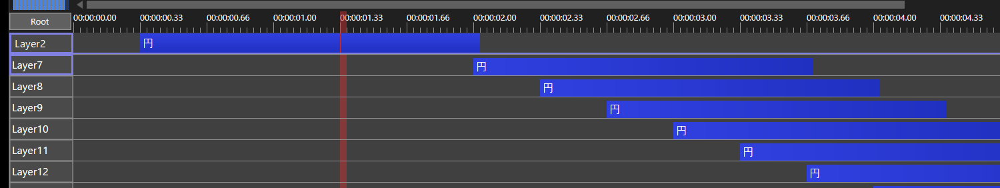

# レイヤー固定（layer_pin.aux2）

AviUtl ExEdit2 のレイヤー編集で、指定したレイヤーを**縦にスクロールしても一番上に表示し続ける**汎用プラグインです。
背景・BGM・カメラ制御など、いつも触るレイヤーを見失わずに下のレイヤーを編集できます。

## 導入

1. [Releases](https://github.com/ar-ca-na/aviutl2-layer-pin/releases) から zip を落として展開します。
2. `layer_pin.aux2` を `C:\ProgramData\aviutl2\Plugin\` に入れます。
3. AviUtl2 を起動し、「スクリプト・プラグインの追加」の確認で許可します。

## 使い方

- **固定する・やめる**：レイヤー名（`Layer1` など）を右クリックし、メニューの一番下の「このレイヤーを一番上に固定」を選びます。
  選ぶたびに ON/OFF が切り替わり、固定中はチェックが付きます。
- **複数固定できます。** 固定したレイヤーが画面の上へ流れたものから順に、一番上に積み重なります。
- 固定したレイヤーは、本来の位置に見えているときもレイヤー名の欄が太い枠で囲まれます。
- 一番上に出ている固定の行では、次の操作ができます。
  - オブジェクトをクリックして選択
  - 左右にドラッグして時間を移動、下の行や別の固定の行へドラッグしてレイヤーを移動
  - 空いた所をクリックして現在位置を移動
  - 右クリックで本体のメニュー（オブジェクト・空いた所・レイヤー名の欄それぞれのもの）。
    メニューを出している間だけ、その固定レイヤーの本来の行が同じ高さに来るようにタイムラインを縦にずらし、閉じると元に戻します。
- 固定の行にも中間点の▼が出ます。
- 固定はシーンごとに、プロジェクトファイルへ保存されます。

## 見え方

固定の行は、固定したレイヤーの本来の行が見えなくなったときだけ現れます。一番上までスクロールすれば、すべてのレイヤーが本来の位置に見えます。

| 例：Layer4 と Layer7 を固定 | 一番上に積まれる行 |
|---|---|
| Layer1〜4 が一番上の位置 | なし |
| Layer5〜6 が一番上の位置 | Layer4 |
| Layer7 以降が一番上の位置 | Layer4、Layer7 |

固定の行が出ている間は、その下にある本来の行が隠れます。1 段上へスクロールすれば見えます。本来の行が少なくとも 1 行は見えるように、積む数を抑えています。

## できないこと・注意

- 固定の行の上では、端をつまんだ長さの変更・複数選択・中間点のドラッグはできません。本来の行で操作してください。
- 固定はレイヤー番号で覚えます。レイヤーの挿入・削除や、レイヤー名のドラッグで並びを変えても、固定は元の番号に残ります。
- 本体のレイヤー編集には別の窓が無いため、その上に自前の窓を重ねて表示しています。
  レイヤー名のメニューへの項目追加と、右クリックのメニューが閉じたことの検出は、本体の `TrackPopupMenu` の呼び出しを差し替えて行っています。

## 更新履歴

- v1.0.3：新しいスクリプト・プラグインを入れた後の起動（「スクリプト・プラグインの追加」の確認が出るとき）に AviUtl2 が落ちる不具合を直した。プロジェクトの読み込みが終わるまで、またダイアログが開いている間は本体の機能を呼ばないようにした。
- v1.0.2：固定の行の右クリックで本体のメニューを出すようにした。オブジェクトの高さ・色の向き・中間点の▼を本体に合わせた。ドラッグでレイヤー名の欄へはみ出す・0 フレームより前へ動く不具合を直した。
- v1.0.1：固定があるとプレビュー再生が数コマで止まる不具合を直した。
- v1.0.0：最初の版。

## 動作確認

AviUtl ExEdit2 2.1.12（Windows 11、64bit）。

## ビルド

MinGW-w64（x86_64）の `g++` を PATH に入れて `build.bat` を実行します。

## ライセンス

MIT License（[LICENSE](LICENSE)）。

`src/sdk/` の `plugin2.h` と `logger2.h` は AviUtl ExEdit2 Plugin SDK（Copyright (c) 2025 Kenkun、MIT License、[src/sdk/LICENSE.txt](src/sdk/LICENSE.txt)）のファイルで、文字コードを UTF-8 に変えています。
